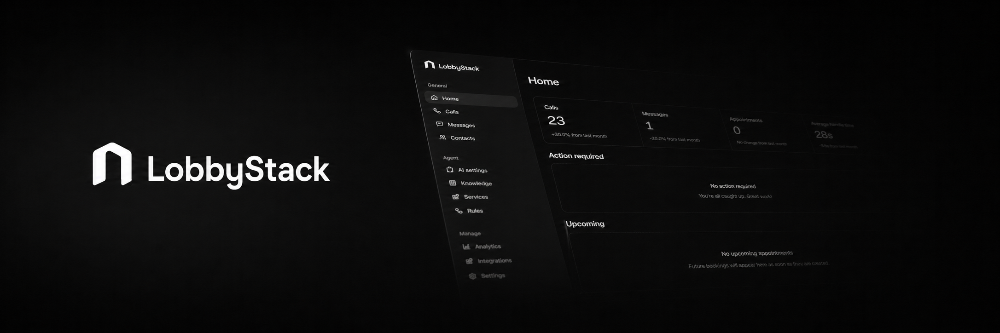

<p align="center">
  
</p>

<div align="center">

# LobbyStack

### The open-source AI receptionist for phone calls and appointments

LobbyStack is an open-source AI receptionist platform for small businesses. It answers phone calls, books appointments, handles appointment changes, and transfers calls to a person when needed.

It is built for clinics, salons, repair shops, local service companies, restaurants, and any business that loses revenue when nobody is available to answer the phone.

LobbyStack gives teams a modern AI front desk that can be hosted in the cloud or self-hosted on their own infrastructure.

[Website](https://lobbystack.com) &middot; [Try the app](https://app.lobbystack.com/signup) &middot; [Docs](https://docs.lobbystack.com) &middot; [Self-hosting](https://docs.lobbystack.com/self-hosting/overview) &middot; [GitHub](https://github.com/lobbystack/lobbystack)

[](./LICENSE) [](https://github.com/lobbystack/lobbystack) [](https://www.typescriptlang.org/) [](https://www.postgresql.org/) [](https://docs.lobbystack.com/self-hosting/overview)

[](https://railway.com/deploy/lobbystack)

</div>

## Why teams use LobbyStack

Most AI receptionist tools are closed, expensive, and difficult to adapt to real business workflows. LobbyStack is different.

- **Open source by default.** Inspect the code, self-host it, extend it, and keep control of your data.
- **Built for real phone calls.** Handle natural voice conversations, interruptions, live transfers, and messages for your team.
- **Calls and texts in one place.** Review calls, recordings, transcripts, and incoming texts from the same dashboard.
- **Scheduling built in.** Book, reschedule, and cancel appointments through Google Calendar.
- **Designed for small businesses.** Guided setup, transparent pricing, and no enterprise-only feature gatekeeping.
- **Human fallback.** Transfer calls or escalate messages when the AI should not handle something alone.

## Core features

### ☎️ AI phone receptionist

LobbyStack answers inbound calls with a natural voice agent trained on your business information. It can answer common questions, collect caller details, take messages, qualify requests, offer appointment slots, and transfer to a human when required.

### 💬 Text messages

LobbyStack saves texts sent to your business number and alerts your team. You read the thread and reply by hand from the dashboard. The AI doesn't answer texts; STOP and HELP get fixed replies.

### 📅 Appointment scheduling

LobbyStack connects to Google Calendar, checks availability, offers time slots, books appointments, and sends a confirmation text and one reminder text 24 hours before, if the caller agrees. Callers can also reschedule or cancel during a later call.

### 📚 Knowledge base

Upload business information, FAQs, services, pricing, policies, and internal notes. The AI uses this knowledge to answer accurately and consistently.

### 🧑‍💼 Human handoff

LobbyStack can transfer a live call, take a message, or notify the team by email or opt-in SMS when a person needs to respond.

### 📥 Shared inbox

Review calls, SMS threads, transcripts, recordings, appointments, and customer details from one dashboard.

### 🔌 Integrations

LobbyStack connects to Google Calendar to check availability and book appointments. It doesn't connect to other calendars or CRMs yet.

## Use cases

LobbyStack can be adapted for many local business workflows:

- Clinics and healthcare offices
- Salons, spas, and barbershops
- Auto repair shops
- Home service companies
- Restaurants
- Dental offices
- Law firms and professional services
- Property managers
- Any business that receives appointment, pricing, hours, or availability questions by phone

## Product areas

| Area | What it gives you |
| --- | --- |
| Voice reception | Inbound phone and browser calls answered by OpenAI GPT-Live, with Twilio phone numbers. |
| Business knowledge | Answers from structured business facts, text entries, documents, and imported website pages. |
| Booking | Service-aware scheduling with availability checks and calendar handoff. |
| Appointment changes | Safer cancellation and rescheduling flows with appointment lookup and verification. |
| Human handoff | Live transfer and follow-up tasks for calls that need staff attention. |
| Messages | Incoming texts with manual replies, connected to customer history. |
| Website widget | Embeddable chat, lead capture, and browser calls with per-site access controls. Restricted: new widget keys are off unless you set `WIDGET_KEY_ISSUANCE_ENABLED=true`. |
| Dashboard | Calls, messages, contacts, appointments, recordings, transcripts, follow-ups, and analytics together. |
| Usage and billing | Hosted plans, voice usage, alert SMS, transfer attempts, storage, and spending caps. |
| Bring your own API keys | Self-hosted deployments can use your own Twilio, OpenAI-compatible AI, calendar, email, analytics, and billing provider credentials. |

## Technology

| Layer | Main components |
| --- | --- |
| App | Next.js, React, Tailwind CSS, shadcn/ui |
| Backend | PostgreSQL, Drizzle ORM, Redis, BullMQ |
| Voice | OpenAI GPT-Live over SIP and WebRTC, Twilio Elastic SIP Trunking |
| Agent | Vercel AI SDK, `gpt-6-luna` or any OpenAI-compatible model |

## Hosted and open source

LobbyStack is open source with a hosted cloud service.

Use **LobbyStack Cloud** when you want the product managed for you. You still control the receptionist behavior, knowledge, services, rules, numbers, integrations, and team workflow from the app.

Self-host when your team wants to run the stack on your own infrastructure, bring your own API keys, and use your own PostgreSQL, Twilio, OpenAI-compatible AI, calendar, analytics, billing, and email provider accounts.

To self-host on Railway, deploy the [LobbyStack template](https://railway.com/deploy/lobbystack). Railway generates every secret and database password, and you enter an OpenAI API key and your Twilio credentials.

After deploying, set a few variables in Railway:

- **Email:** `SMTP_*` and `EMAIL_FROM` on the worker. Password resets, verification codes, and invites fail without them.
- **Phone calls:** an OpenAI webhook to `https://your_admin_domain/api/webhooks/openai/live`, its secret as `OPENAI_WEBHOOK_SECRET` on the admin, and your Twilio Elastic SIP trunk as `TWILIO_SIP_TRUNK_SID` on the worker. See [`docs/voice/runtime.md`](./docs/voice/runtime.md#set-up-the-phone-path).
- **Optional:** `FIRECRAWL_API_KEY` on the worker for website import, and `GOOGLE_CLIENT_ID` and `GOOGLE_CLIENT_SECRET` on the admin for Google Calendar.
- **Custom domain:** `APP_BASE_URL` on the admin. The other URL variables reference it.

The [self-hosting guide](https://docs.lobbystack.com/self-hosting/overview#after-deploying) has each step.

Full product control in the hosted app. Infrastructure ownership when you self-host. Same open-source core either way.

## Architecture for contributors

LobbyStack is a TypeScript monorepo with PostgreSQL as the durable source of truth. OpenAI hosts call audio; the admin app starts each call and the worker runs it.

```text
apps/
  admin/           Next.js dashboard and HTTP API
  worker/          asynchronous jobs, outbox dispatch, and live calls
packages/embed/    Vite bundle for the embeddable website widget loader
packages/          database, domain, agent core, jobs, providers, telemetry, and shared contracts
mintlify/          public documentation source
docs/              architecture notes, ADRs, provider docs, and validation notes
```

Read the [self-hosting overview](https://docs.lobbystack.com/self-hosting/overview) for the provider map and deployment expectations, or use the [Docker Compose guide](https://docs.lobbystack.com/self-hosting/docker-compose) for the official single-host baseline.

## Get started

### Use the hosted app

1. [Create a LobbyStack account](https://app.lobbystack.com/signup).
2. Verify your mobile number.
3. Import website knowledge, or skip and add knowledge manually later.
4. Choose a plan.
5. Claim a business number on Starter or Pro.
6. Configure AI settings, services, knowledge, and rules before sending live calls.

The full hosted walkthrough lives in the [setup guide](https://docs.lobbystack.com/quickstart).

### Run local development

```bash
cp .env.example .env
pnpm install
docker compose up -d postgres redis
pnpm db:migrate
pnpm dev
```

Local development stores recordings and uploads under `.lobbystack/storage`. Set `STORAGE_PROVIDER=s3` when you need to test an S3-compatible service.

Mock providers are part of the default development path, so contributors can exercise flows without live Twilio, AI, calendar, or email credentials. Provider setup notes live in the [docs](https://docs.lobbystack.com/self-hosting/providers).

### Deploy with Docker Compose

```bash
git clone https://github.com/lobbystack/lobbystack.git
cd lobbystack
pnpm install
cp .env.example .env
# Replace every placeholder before exposing the stack.
docker compose --env-file .env up -d --build
```

The stack uses stdout logs and health endpoints without running monitoring containers. Set `OTEL_EXPORTER_OTLP_ENDPOINT` and `OTEL_EXPORTER_OTLP_HEADERS` to send server telemetry to PostHog or another OTLP-compatible backend.

For prerequisites, local smoke vs production go-live, helper scripts, and troubleshooting, see the [Docker Compose self-hosting guide](https://docs.lobbystack.com/self-hosting/docker-compose).

## Environment variables

Copy `.env.example` to `.env` and replace every `replace-with-…` placeholder before you expose a stack. A blank default means the variable is optional or the feature is off until you set it. Variables are grouped by prefix, in the same order as `.env.example`.

### AI

| Variable | Default | Description |
| --- | --- | --- |
| `AI_CHAT_API_KEY` | | API key for website chat and calls. Falls back to `OPENAI_API_KEY`. |
| `AI_CHAT_BASE_URL` | `https://api.openai.com/v1` | Endpoint for website chat and calls. Other OpenAI-compatible endpoints use chat completions. |
| `AI_CHAT_MODEL` | | Chat model. Leave blank for `gpt-6-luna` on OpenAI; set it for any other endpoint. |
| `AI_CHAT_REASONING_EFFORT` | | OpenAI only: `none`, `minimal`, `low`, `medium`, `high` (default) or `xhigh`. |
| `AI_CHAT_PROVIDER_NAME` | `openai` | Provider name recorded with usage and cost. |
| `AI_SUMMARY_MODEL` | | Model the worker uses to write a one-line summary of each finished call, on the `AI_CHAT_*` endpoint. Blank uses `AI_CHAT_MODEL`. A different model reports no cost, because the `AI_CHAT_*` prices describe the chat model. |
| `AI_SUMMARY_REASONING_EFFORT` | | OpenAI only: `none`, `minimal`, `low` (default), `medium`, `high` or `xhigh`. |
| `AI_DELEGATION_MODEL` | | Model the worker uses to answer GPT-Live's delegated requests on the `AI_CHAT_*` endpoint while the caller waits. Blank uses `AI_CHAT_MODEL`. A different model reports no cost. |
| `AI_DELEGATION_REASONING_EFFORT` | | OpenAI only: `none`, `minimal`, `low` (default), `medium`, `high` or `xhigh`. |
| `AI_DELEGATION_SERVICE_TIER` | | OpenAI only: `auto`, `default`, `flex` or `priority` (default). Priority answers faster and costs twice the standard token price. |
| `AI_CHAT_INPUT_COST_PER_MILLION_TOKENS` | | Chat model input price in USD per million tokens, so chat, call summaries and live-call delegations record their cost. For `gpt-6-luna`: 0.1. |
| `AI_CHAT_CACHED_INPUT_COST_PER_MILLION_TOKENS` | | Cached input price. Falls back to the input price when unset. For `gpt-6-luna`: 0.01. |
| `AI_CHAT_OUTPUT_COST_PER_MILLION_TOKENS` | | Output price. For `gpt-6-luna`: 0.5. |
| `AI_CHAT_PRICING_VERSION` | | Version label for the chat prices. |
| `AI_CHAT_PRICING_SOURCE` | | Where the chat prices come from. |
| `AI_CHAT_PRICING_EFFECTIVE_DATE` | | Date the chat prices took effect. A configured chat price is used only when all three pricing metadata fields are set. |
| `AI_EMBEDDING_API_KEY` | | API key for embeddings. Falls back to `OPENAI_API_KEY`. |
| `AI_EMBEDDING_BASE_URL` | `https://api.openai.com/v1` | Embedding endpoint. |
| `AI_EMBEDDING_MODEL` | `text-embedding-3-small` | Embedding model. |
| `AI_EMBEDDING_PROVIDER_NAME` | `openai` | Provider name recorded with embedding usage. |
| `AI_EMBEDDING_REVISION` | `1` | Embedding revision number. |
| `AI_EMBEDDING_INPUT_COST_PER_MILLION_TOKENS` | | Embedding price in USD per million tokens. |
| `AI_EMBEDDING_PRICING_VERSION` | | Version label for the embedding price. |
| `AI_EMBEDDING_PRICING_SOURCE` | | Where the embedding price comes from. |
| `AI_EMBEDDING_PRICING_EFFECTIVE_DATE` | | Date the embedding price took effect. A configured embedding price is used only when all three pricing metadata fields are set. |
| `AI_EMBEDDING_TIMEOUT_MS` | `30000` | Timeout for each embedding request. A large document sends one request per 128 chunks. |
| `AI_EMBEDDING_MAX_PARALLEL_CALLS` | `4` | Maximum number of embedding requests in flight at once. |

### App

| Variable | Default | Description |
| --- | --- | --- |
| `APP_BASE_URL` | `http://localhost:13000` | Public base URL of the admin app. Also the default for `AUTH_TRUSTED_ORIGINS` and the base for webhook callbacks. |
| `APP_HOSTNAME` | `localhost` | Hostname the Docker Compose health check sends in its `Host` header. |

### Brand

| Variable | Default | Description |
| --- | --- | --- |
| `BRAND_APP_NAME` | | Name the dashboard shows instead of LobbyStack. Wins over what the deployment's first owner chooses in onboarding. Give it to the admin build too, so prerendered sign-in pages show it straight away. |
| `BRAND_LOGO_URL` | | Logo the dashboard shows. An `https` URL or a path on the dashboard such as `/brand/logo.svg`. Same precedence and build note as `BRAND_APP_NAME`. |

### Content

| Variable | Default | Description |
| --- | --- | --- |
| `CONTENT_RETENTION_ENABLED` | `true` | Plan-based content retention. Free keeps 30 days; paid plans keep messages 365, transcripts 90, recordings 90 and follow-ups 365. Set to `false` only to disable content deletion deployment-wide. |
| `CONTENT_RETENTION_POLICY_JSON` | | Optional override for the paid periods. Free stays capped at 30 days. |
| `CONTENT_RETENTION_DATABASE_URL` | | Database URL for backfill tooling. Must be an explicit local or approved worker-role URL. |

### Email

| Variable | Default | Description |
| --- | --- | --- |
| `EMAIL_FROM` | `LobbyStack <no-reply@example.com>` | Sender of outgoing email. |
| `EMAIL_REPLY_TO` | | Reply-to address for outgoing email. |

### Finance

| Variable | Default | Description |
| --- | --- | --- |
| `FINANCE_EXPORT_ENABLED` | `false` | Turns on the finance export. Also required for `LOBBYSTACK_FINANCE_EXPORT_DATABASE_URL`. |
| `FINANCE_EXPORT_TOKEN` | | Token that authorizes finance export requests. |

### Firecrawl

| Variable | Default | Description |
| --- | --- | --- |
| `FIRECRAWL_API_KEY` | | API key for importing website knowledge. |
| `FIRECRAWL_BASE_URL` | | Firecrawl endpoint, for a self-hosted instance. |

### Google

One Google OAuth client serves Google Calendar and "Continue with Google" sign-in. Sign-in turns on once both `GOOGLE_CLIENT_ID` and `GOOGLE_CLIENT_SECRET` are set. Register two redirect URIs on the client: `GOOGLE_REDIRECT_URI` for Calendar, and `APP_BASE_URL` + `/api/auth/callback/google` for sign-in, for example `https://app.example.com/api/auth/callback/google`.

| Variable | Default | Description |
| --- | --- | --- |
| `GOOGLE_CLIENT_ID` | | OAuth client ID. |
| `GOOGLE_CLIENT_SECRET` | | OAuth client secret. |
| `GOOGLE_REDIRECT_URI` | `http://localhost/api/calendar/google/callback` | Calendar OAuth redirect URI. |

### Instagram

Optional Instagram direct messages. Needs a Meta app with the Instagram product and Business Login. Its webhook callback is `APP_BASE_URL` + `/api/webhooks/instagram`, verified with `INSTAGRAM_WEBHOOK_VERIFY_TOKEN` and subscribed to the `messages` field.

| Variable | Default | Description |
| --- | --- | --- |
| `INSTAGRAM_APP_ID` | | Meta app ID. |
| `INSTAGRAM_APP_SECRET` | | Meta app secret. |
| `INSTAGRAM_REDIRECT_URI` | `http://localhost/api/integrations/instagram/callback` | OAuth redirect URI. |
| `INSTAGRAM_WEBHOOK_VERIFY_TOKEN` | | Token Meta uses to verify the webhook. |

### Internal

| Variable | Default | Description |
| --- | --- | --- |
| `INTERNAL_SERVICE_SECRET` | `replace-with-a-long-service-secret` | Secret shared by the admin and the worker for internal service calls. Production startup refuses a placeholder. |
| `INTERNAL_SERVICE_TOKEN` | `replace-with-a-local-service-token` | Token for internal service requests. Production startup refuses a placeholder. |

### LobbyStack

| Variable | Default | Description |
| --- | --- | --- |
| `LOBBYSTACK_APP_PASSWORD` | `replace-with-app-password` | Password of the app database role. |
| `LOBBYSTACK_AUTH_PASSWORD` | `replace-with-auth-password` | Password of the auth database role. |
| `LOBBYSTACK_WORKER_PASSWORD` | `replace-with-worker-password` | Password of the worker database role. |
| `LOBBYSTACK_DISPATCHER_PASSWORD` | `replace-with-dispatcher-password` | Password of the outbox dispatcher database role. |
| `LOBBYSTACK_MIGRATOR_PASSWORD` | `replace-with-migrator-password` | Password of the migrator database role. |
| `LOBBYSTACK_READONLY_PASSWORD` | `replace-with-readonly-password` | Password of the read-only database role. |
| `LOBBYSTACK_FINANCE_EXPORT_DATABASE_URL` | | URL for the read-only `lobbystack_finance_export` PostgreSQL role. Disabled unless `FINANCE_EXPORT_ENABLED=true`. Do not reuse the app or worker role. |
| `LOBBYSTACK_MAINTENANCE_MODE` | `false` | Startup isolation only. Recreate all runtimes after changing it, and drain active work first. Not a durable webhook buffer. |
| `LOBBYSTACK_CERTIFICATION_MODE` | `false` | For temporary certification environments only. Missing allowlists fail closed. Blocks phone purchase, release and webhook reconfiguration, and live Polar billing. |
| `LOBBYSTACK_CERTIFICATION_EMAILS` | | Email allowlist for certification mode. |
| `LOBBYSTACK_CERTIFICATION_PHONES` | | Phone number allowlist for certification mode. |
| `LOBBYSTACK_CERTIFICATION_CALENDARS` | | Calendar allowlist for certification mode. |

Services build each role's connection string from `DATABASE_URL` and the role password above. Set `LOBBYSTACK_<ROLE>_DATABASE_URL` only to point a role at a different host.

### Local storage

| Variable | Default | Description |
| --- | --- | --- |
| `LOCAL_STORAGE_PATH` | `.lobbystack/storage` | Where recordings and uploads are stored when `STORAGE_PROVIDER=local`. |
| `LOCAL_STORAGE_SIGNING_SECRET` | `replace-with-a-long-local-storage-signing-secret` | Secret that signs local storage URLs. |

### Mailpit

Optional host ports for the Mailpit container in Docker Compose, which catches outgoing email in development.

| Variable | Default | Description |
| --- | --- | --- |
| `MAILPIT_SMTP_PORT` | `1025` | Host port for Mailpit's SMTP server. Point `SMTP_PORT` at it. |
| `MAILPIT_UI_PORT` | `8025` | Host port for the Mailpit web UI. |

### Next.js public values

The admin build writes these in, so set them before building.

| Variable | Default | Description |
| --- | --- | --- |
| `NEXT_PUBLIC_TURNSTILE_SITE_KEY` | | Cloudflare Turnstile site key. |
| `NEXT_PUBLIC_LANDING_SITE_URL` | | Where the admin's website link goes. Empty links to LobbyStack's. |
| `NEXT_PUBLIC_TERMS_URL` | | Terms page link. Empty links to LobbyStack's. |
| `NEXT_PUBLIC_PRIVACY_URL` | | Privacy page link. Empty links to LobbyStack's. |
| `NEXT_PUBLIC_DOCS_SITE_URL` | | Docs link. Empty links to LobbyStack's. |
| `NEXT_PUBLIC_CONTACT_EMAIL` | | The one address people write to. Empty uses LobbyStack's. |
| `NEXT_PUBLIC_APP_URL` | `http://localhost:13000` | Dashboard origin for sign-in links. |
| `NEXT_PUBLIC_LIVE_CALL_ENDPOINT` | `http://localhost:13000/api/voice/live/session` | Session endpoint for the voice demo. |
| `NEXT_PUBLIC_WEB_CALL_BUSINESS_SLUG` | | Business the voice demo calls. |
| `NEXT_PUBLIC_POSTHOG_PROJECT_TOKEN` | | Client-side PostHog analytics token. Included in the browser bundle, so not a secret. |
| `NEXT_PUBLIC_POSTHOG_HOST` | `https://ts.lobbystack.com` | LobbyStack's PostHog managed reverse proxy. Point it at your own PostHog host when you use your own project. |

### Onboarding

| Variable | Default | Description |
| --- | --- | --- |
| `ONBOARDING_FOLLOWUP_FROM` | | Sender address of the founder check-in sent 24 hours after onboarding to owners who have not come back. Leave empty to disable. |
| `ONBOARDING_FOLLOWUP_SENDER_NAME` | | Sender name for that check-in. |

### OpenAI

| Variable | Default | Description |
| --- | --- | --- |
| `OPENAI_API_KEY` | | OpenAI key. Used for GPT-Live and as the fallback for the `AI_CHAT_*` and `AI_EMBEDDING_*` keys. |
| `OPENAI_WEBHOOK_SECRET` | | Secret that verifies OpenAI's incoming-call webhook. |

### OpenTelemetry

| Variable | Default | Description |
| --- | --- | --- |
| `OTEL_EXPORTER_OTLP_ENDPOINT` | | OTLP endpoint for server telemetry, for example PostHog. |
| `OTEL_EXPORTER_OTLP_HEADERS` | | Headers sent with OTLP requests, such as an auth header. |

### Polar

| Variable | Default | Description |
| --- | --- | --- |
| `POLAR_ACCESS_TOKEN` | | Polar API access token. |
| `POLAR_WEBHOOK_SECRET` | `replace-with-polar-webhook-secret` | Secret that verifies Polar webhooks. |
| `POLAR_ACCEPT_LEGACY_BUSINESS_IDS` | `false` | Accept legacy Convex business IDs in Polar webhooks. |
| `POLAR_ORGANIZATION_ID` | | Polar organization ID. |
| `POLAR_API_BASE_URL` | | Polar API base URL, for example the sandbox. |
| `POLAR_STARTER_MONTHLY_PRODUCT_ID` | | Product ID of the Starter monthly plan. |
| `POLAR_STARTER_ANNUAL_PRODUCT_ID` | | Product ID of the Starter annual plan. |
| `POLAR_PRO_MONTHLY_PRODUCT_ID` | | Product ID of the Pro monthly plan. |
| `POLAR_PRO_ANNUAL_PRODUCT_ID` | | Product ID of the Pro annual plan. |

### Postgres

| Variable | Default | Description |
| --- | --- | --- |
| `POSTGRES_PASSWORD` | `replace-with-a-long-local-password` | Password of the `postgres` superuser in the Docker Compose database. Keep it in step with `DATABASE_URL`. |
| `POSTGRES_PORT` | `15433` | Host port for the Docker Compose database. |

### PostHog

| Variable | Default | Description |
| --- | --- | --- |
| `POSTHOG_API_KEY` | | Server-side PostHog key for product analytics. |
| `POSTHOG_HOST` | `https://us.i.posthog.com` | PostHog ingestion host. |

### Redis

| Variable | Default | Description |
| --- | --- | --- |
| `REDIS_PORT` | `16380` | Host port for the Docker Compose Redis. |
| `REDIS_URL` | `redis://127.0.0.1:16380` | Redis connection URL. Needed for the public API rate limit. |

### S3

Used when `STORAGE_PROVIDER=s3`.

| Variable | Default | Description |
| --- | --- | --- |
| `S3_ENDPOINT` | | Endpoint of the S3-compatible service. |
| `S3_BUCKET` | `lobbystack` | Bucket name. |
| `S3_REGION` | `us-east-1` | Bucket region. |
| `S3_ACCESS_KEY_ID` | | Access key ID. |
| `S3_SECRET_ACCESS_KEY` | | Secret access key. |
| `S3_FORCE_PATH_STYLE` | `false` | Use path-style URLs, as MinIO needs. |

### SMTP

| Variable | Default | Description |
| --- | --- | --- |
| `SMTP_HOST` | | SMTP server host. |
| `SMTP_PORT` | `587` | SMTP server port. |
| `SMTP_SECURE` | `false` | Use TLS from the start of the connection. |
| `SMTP_USERNAME` | | SMTP username. |
| `SMTP_PASSWORD` | | SMTP password. |

### Twilio

| Variable | Default | Description |
| --- | --- | --- |
| `TWILIO_ACCOUNT_SID` | | Twilio account SID. |
| `TWILIO_AUTH_TOKEN` | `replace-with-twilio-auth-token` | Twilio auth token. |
| `TWILIO_SIP_TRUNK_SID` | | Twilio Elastic SIP trunk for GPT-Live phone calls. Numbers must sit on it, and the worker refuses to provision a number without it. See `docs/voice/runtime.md`. |
| `TWILIO_VERIFY_SERVICE_SID` | | Twilio Verify service that texts the onboarding phone code (admin). |
| `TWILIO_GB_BUNDLE_SID` | | Approved regulatory bundle for UK numbers. Set it on the admin and the worker. |
| `TWILIO_AU_BUNDLE_SID` | | Regulatory bundle for Australian numbers. |
| `TWILIO_AU_ADDRESS_SID` | | Address the Australian bundle needs. |
| `TWILIO_NZ_BUNDLE_SID` | | Regulatory bundle for New Zealand numbers. |
| `TWILIO_NZ_ADDRESS_SID` | | Address the New Zealand bundle needs. |
| `TWILIO_ALERT_SMS_FROM` | | The shared sender. Cloud businesses text operator alerts, customer appointment texts and change codes from it, and it answers STOP, START and HELP through `/api/webhooks/twilio/sms`. Self-hosted businesses text from their own number. |
| `TWILIO_ALERT_ACCOUNT_SID` | | Optional separate account that owns the shared sender. Leave blank for the default account. |
| `TWILIO_ALERT_API_KEY_SID` | | API key SID for that account. The worker key needs only `/twilio/messaging/messages/create`. |
| `TWILIO_ALERT_API_KEY_SECRET` | | API key secret for that account. |
| `TWILIO_ALERT_WEBHOOK_KEY_ID` | | Admin only: ID of the dedicated webhook signing key. Never use the alert account's auth token. |
| `TWILIO_ALERT_WEBHOOK_SECRET` | | Admin only: the signing key's secret. Apply it to the status callback URL and to `/api/webhooks/twilio/sms` when the shared sender's SMS webhook points at this app. |
| `TWILIO_SMS_WEBHOOK_URL` | `http://127.0.0.1:13000/api/webhooks/twilio/sms` | Public URL of the SMS webhook. |
| `TWILIO_STATUS_CALLBACK_URL` | `http://127.0.0.1:13000/api/webhooks/twilio/status` | Public URL of the status callback. |

Twilio sells UK, Australian and New Zealand numbers only under an approved regulatory bundle, and Australian and New Zealand numbers also need the bundle's address. See "Sell numbers in the UK, Australia and New Zealand" in `docs/voice/runtime.md`.

### Web calls

| Variable | Default | Description |
| --- | --- | --- |
| `WEB_CALL_ALLOWED_ORIGINS` | `http://localhost:13000,http://lobbystack.localhost:13000` | Comma-separated origins allowed to start browser calls. |
| `WEB_CALL_PUBLIC_BUSINESS_SLUG` | | Business that public browser calls reach. |

### Widget

| Variable | Default | Description |
| --- | --- | --- |
| `WIDGET_SESSION_SECRET` | `replace-with-a-long-widget-session-secret` | Secret that signs widget sessions. |
| `WIDGET_KEY_ISSUANCE_ENABLED` | `false` | Whether new chat and widget keys can be issued. Existing keys continue working. Keep issuance restricted. |

### Worker

| Variable | Default | Description |
| --- | --- | --- |
| `WORKER_PORT` | `13002` | Port the worker listens on. |
| `WORKER_INTERNAL_URL` | `http://127.0.0.1:13002` | URL the admin uses to reach the worker. |

### Other

| Variable | Default | Description |
| --- | --- | --- |
| `ADMIN_PORT` | `13000` | Port the admin app listens on. |
| `ALLOWED_DEV_ORIGINS` | | Dev only: comma-separated extra hosts allowed to load the admin in `pnpm dev`. |
| `AUTH_TRUSTED_ORIGINS` | | Comma-separated origins allowed to sign in. Defaults to `APP_BASE_URL`. |
| `BETTER_AUTH_SECRET` | `replace-with-at-least-32-random-characters` | Secret for Better Auth sessions. Use at least 32 random characters. |
| `DATABASE_URL` | `postgres://postgres:…@127.0.0.1:15433/lobbystack` | Superuser URL. The migrator bootstraps roles with it, and runtimes derive role URLs from its host. |
| `DEPLOYMENT_MODE` | `self_hosted_standard` | How this deployment runs, for example `self_hosted_standard` or `cloud`. `cloud` turns on LobbyStack Cloud behavior. Unset falls back to `development`. |
| `ENCRYPTION_KEY` | `replace-with-a-long-application-encryption-key` | Also encrypts webhook signing secrets and keys the HMAC for stored API key hashes. Changing it invalidates existing API keys and webhook secrets. |
| `FEEDBACK_TO_EMAIL` | | Address that receives in-app feedback. |
| `HTTP_PORT` | `80` | Host port Docker Compose publishes the web proxy on. |
| `LIVE_PROTOTYPE_ENABLED` | `true` | Turns on GPT-Live for browser and phone calls. The admin receives OpenAI's incoming-call webhook, and the worker holds each call's sideband connection. See `docs/voice/runtime.md`. |
| `MARKETING_HOSTS` | `lobbystack.localhost,www.lobbystack.localhost` | Hosts the admin serves the marketing site on. The first is canonical and the others redirect to it. In `pnpm dev`, open `http://lobbystack.localhost:13000`. Leave empty to serve only the dashboard. Docker images include the site only when built with `MARKETING_SITE=true`. |
| `NUMBER_CLAIM_TOKEN_SECRET` | `replace-with-at-least-32-random-characters` | Secret for phone number claim tokens. Use at least 32 random characters. |
| `OTP_HASH_SECRET` | `replace-with-a-long-otp-hash-secret` | Secret that hashes one-time codes. |
| `PLATFORM_API_KEYS` | | JSON array of platform API keys (`lsp_…`) that onboard and manage businesses through `/api/v1`. `pnpm platform-key:create` makes a key and prints its entry. |
| `PROSPECT_DEMO_OPERATOR_EMAIL` | | Operator email used for prospect demos. |
| `PUBLIC_API_RATE_LIMIT_PER_MINUTE` | `120` | Requests per minute allowed for each public API key (`/api/v1`). Needs `REDIS_URL`. |
| `REQUIRE_EMAIL_VERIFICATION` | `false` | Require users to verify their email before signing in. |
| `SERVICE_VERSION` | `development` | Version label attached to telemetry. |
| `STORAGE_PROVIDER` | `local` | `local` or `s3`. |
| `TRUSTED_CLIENT_IP_HEADER` | | Single-value header that widget IP limits use. Used only when you set it. |
| `TURNSTILE_SECRET_KEY` | | Cloudflare Turnstile secret key. |
| `VOICE_RECOVERY_DATABASE_URL` | | Database URL for voice recovery. Recovery defaults to a read-only report, and applying needs provider evidence. |

## Contributing

Contributions are welcome. Start with [CONTRIBUTING.md](./CONTRIBUTING.md), keep durable business logic in the domain and database layers, and put the receptionist's tools in the agent core.

Before opening a PR, run:

```bash
pnpm typecheck
pnpm build
pnpm test
```

## License

LobbyStack is licensed under the [MIT License](./LICENSE).
